# Micro-OS — an educational RISC-V kernel in Rust (CA-6)

A small operating-system kernel that makes OS mechanisms *visible*. It boots
on an emulated RISC-V machine, runs real tasks with their own stacks, switches
between them on a timer interrupt, synchronises them, allocates memory, lets
programs run in unprivileged **user mode** behind real system calls, and
reports what every mechanism did through structured traces that Python turns
into tables and plots. On screen it appears as **NEXUS OS**, a browser desktop
that drives the running kernel.

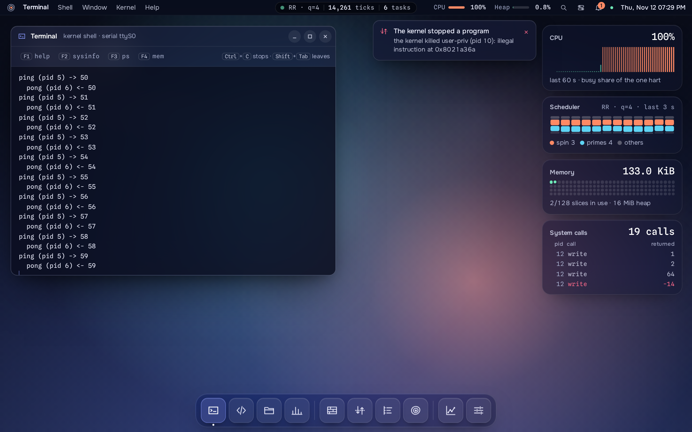

*Above: `user hello` runs in U-mode and reaches the kernel only through
`ecall` (15 system calls); `user priv` tries to read a supervisor register and
the kernel kills just that program; `user badptr` is refused with `-EFAULT`.
Every pixel is live kernel output.*

## At a glance

| | |
|---|---|
| Kernel | Rust `no_std`, RISC-V 64 (S-mode), QEMU `virt` + OpenSBI, 1 hart, 128 MiB |
| Tasks | real context switch (`switch.S`), 16 KiB stacks with overflow canaries, up to 512 tasks |
| Scheduling | 1 ms timer interrupt; 8 policies: RR, Priority, Priority+aging, MLFQ, FCFS, SJF, SRTF, HRRN |
| User mode | U-mode programs, `ecall` system calls (`write`, `exit`, `yield`, `getpid`, `sleep_ms`, `uptime_ms`), faulting programs killed |
| Sync | IRQ-safe spinlock, spinlock, FIFO mutex, semaphore, deadlock detection |
| Memory | own 16 MiB first-fit free-list heap; bump and best-fit for comparison |
| Tests | 34 host unit tests + **68 in-kernel checks** (TC1–TC6, mechanisms, system calls), byte-identical across boots |
| Research | the R3 study *Fairness vs Throughput in CPU Scheduling* re-run on the kernel: 440 runs, H1–H3 supported |
| Linux | same workloads on Linux 6.6 (EEVDF, SCHED_RR) for comparison |
| Micro-OS Linux | a Debian 13 distribution built in 7 measured stages: LAN, Wi-Fi, laptop hardware, APT/aptitude, Snap Store |

## Tour

| | |
|---|---|
| 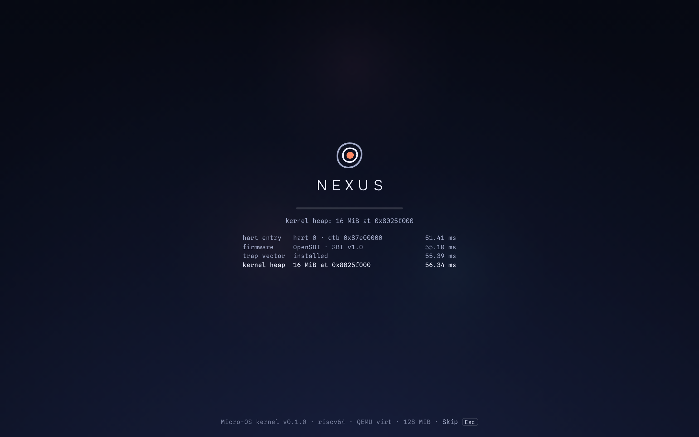 | **Boot.** The boot screen replays this boot's real trace: hart entry, firmware, trap vector, heap, timer, scheduler, shell, each with its timestamp. |
| 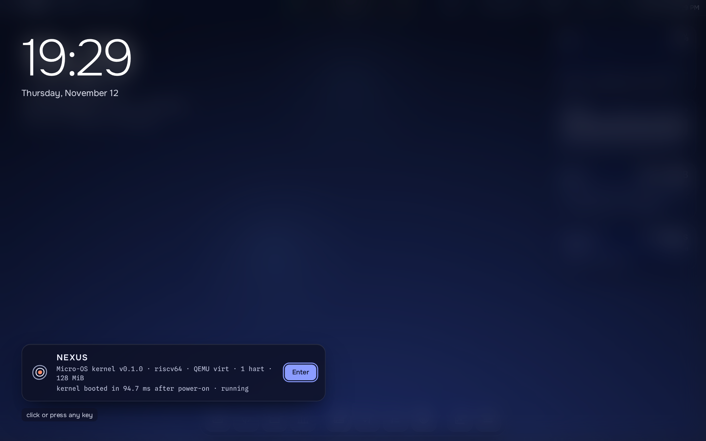 | **Lock screen.** The machine as it boots up, before the desktop. |
| 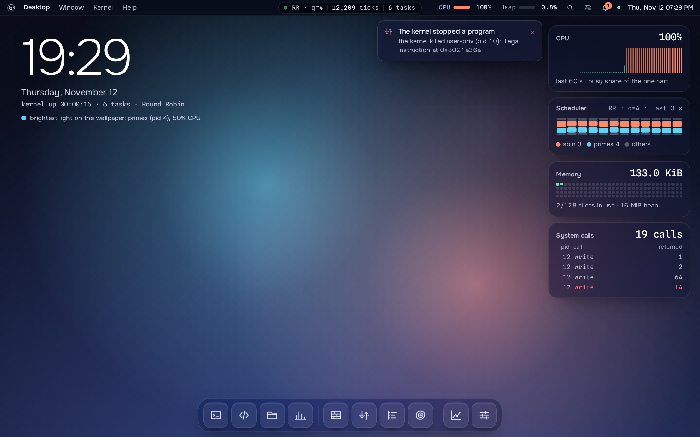 | **Desktop.** Menu bar, dock and widgets, every number live from the kernel. |
| 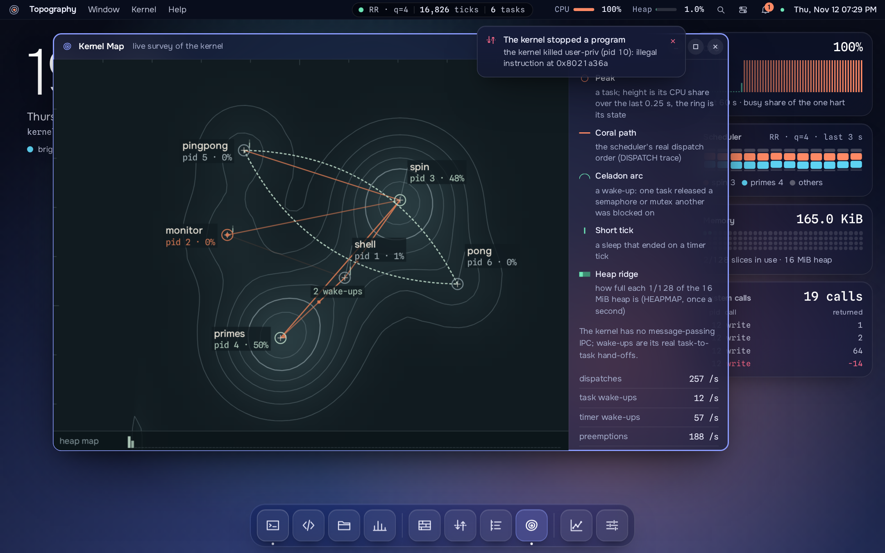 | **Topography.** Each task is a peak whose height is its CPU share; the coral path is the scheduler's real dispatch order and the arcs are real semaphore wake-ups. |
| 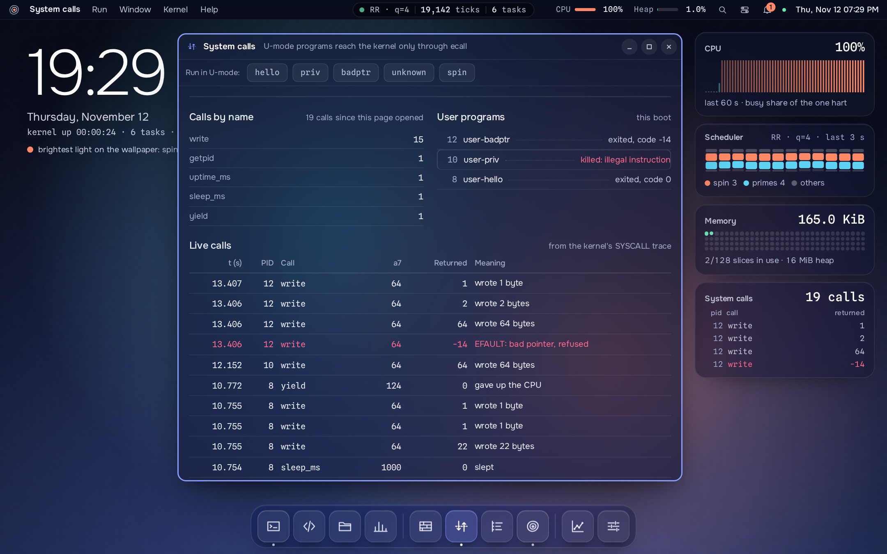 | **System calls.** Live `ecall`s from U-mode programs, and the kernel stopping a program that breaks the rules. |
| 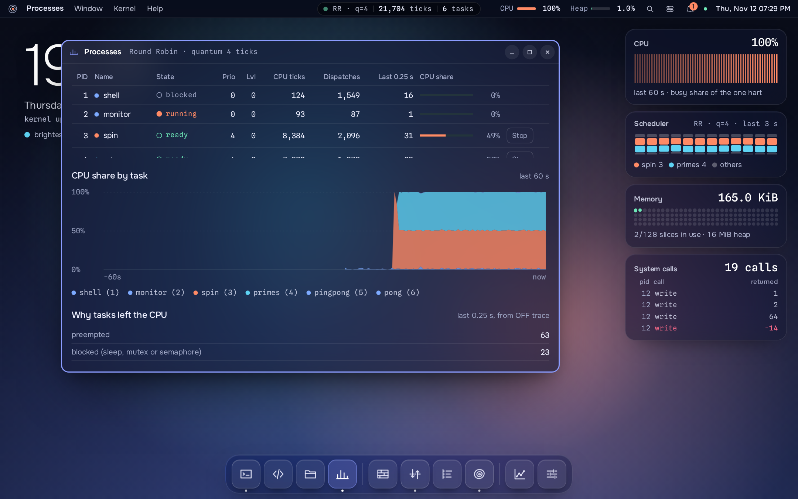 | **Processes.** Task table (state, priority, MLFQ level, CPU ticks, dispatches) and CPU share over the last 60 s. |
| 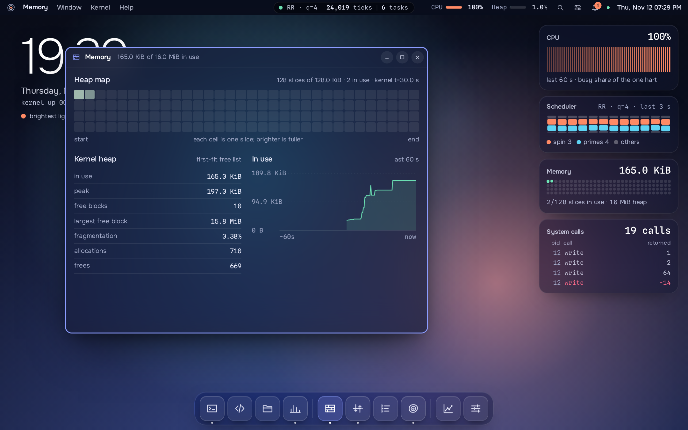 | **Memory.** A map of the 16 MiB heap in 128 slices from the kernel's `HEAPMAP` trace, with fragmentation and allocation counters. |
| 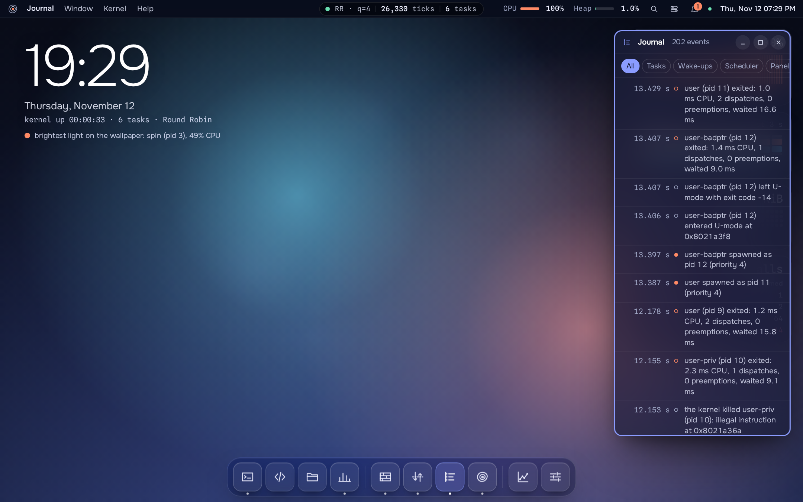 | **Journal.** Every spawn, exit, wake-up and policy event, as the kernel reported it. |
| 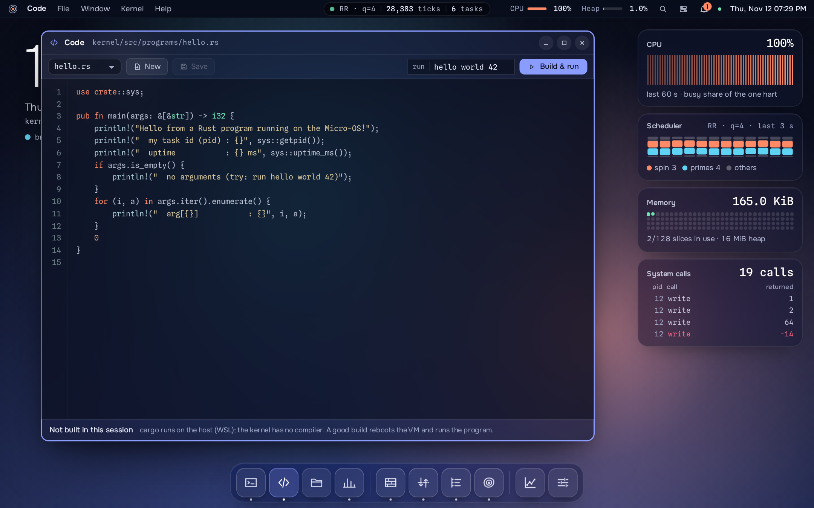 | **Code.** Edit a program in `kernel/src/programs/`; *Build & run* rebuilds the kernel on the host (labelled as such) and runs it. |
| 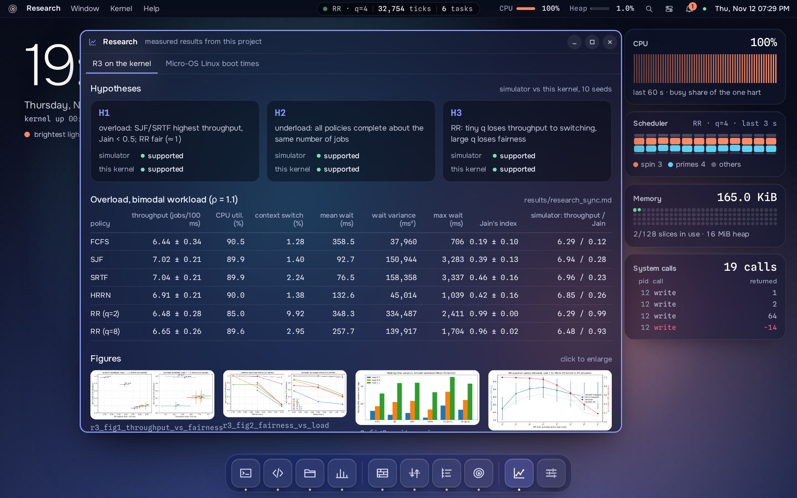 | **Research.** The R3 fairness-vs-throughput results measured on this kernel. |
| 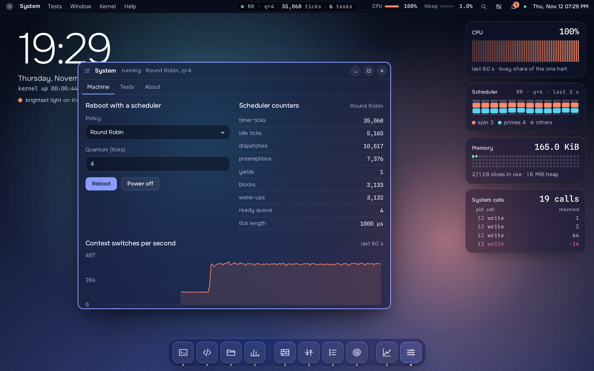 | **System.** Reboot under any of the 8 policies and quantum; machine facts from the kernel. |

Regenerate these pictures from the live system: `scripts/screenshots.py` (see its header).

## Core requirements → code

| Core requirement | Where |
|---|---|
| Rust kernel boot | `kernel/src/boot/` (`entry.S` → `kmain`) |
| Console + diagnostics | `kernel/src/kernel/console.rs`, `panic.rs` (backtraces) |
| Task representation | `kernel/src/task/` (TCB, context, stacks) |
| Ready queue + Round Robin | `core/src/sched/rr.rs`, `kernel/src/scheduler/` |
| Timer-driven preemption | `kernel/src/timer/`, `kernel/src/trap/` |
| Synchronization | `kernel/src/sync/` (IRQ lock, spinlock, mutex, semaphore) |
| Memory allocation | `core/src/mem/` (bump, first-fit/best-fit free list) |
| Integrated demo + tests | `kernel/src/scenarios/` (TC1–TC6 + mechanism demos) |
| **Specialization: Track A + G** | Scheduler engineering: RR, Priority, Priority+aging, MLFQ, **FCFS, SJF, SRTF, HRRN**; research-to-kernel: the R3 study re-run on the kernel ([docs/research_sync.md](docs/research_sync.md)) |
| System interface (Track D) | `kernel/src/user/` (U-mode, `ecall` system calls), `kernel/src/sys.rs`, `programs/`, `shell/` |
| Linux vs Micro-OS (§20) | `linux/compare.py`, [docs/linux_comparison.md](docs/linux_comparison.md) |

## User mode and system calls

`kernel/src/user/` runs programs in RISC-V U-mode on their own user stack.
They cannot execute privileged instructions; the only way into the kernel is
`ecall`:

```text
 U-mode program           trap.S (S-mode)              user::syscall
 a7 = number, a0.. args
 ecall  ────────────────▶ swap to the task's kernel
                          stack (sscratch), save  ───▶ check arguments,
                          the TrapFrame                do the work, a0 = result
 continues after ecall ◀─ restore, sret to U-mode ◀──
```

In the shell: `user hello`, `user priv`, `user badptr`, `user unknown`,
`user spin`. The `syscall` test checks the round trip, that a privileged
instruction kills only the offending program, `-EFAULT` for a bad pointer,
`-ENOSYS` for an unknown call, that the timer preempts user code, and that
the other programs survive. Paging is off, so this is privilege separation,
not memory isolation (stated in the code and docs).

## Micro-OS Linux (`distro/`)

A separate artifact for the extra requirements (network, laptop hardware,
package manager, app store, boot time per component): a Debian 13 system
built one component at a time, each stage booted under UEFI Secure Boot and
timed with `systemd-analyze` (5 boots each).

| Stage | Adds | Boot (s) |
|---|---|---:|
| S0 | minimal base: Linux 6.12, systemd | 4.08 ± 0.58 |
| S1 | LAN: NetworkManager, Realtek Ethernet | 4.18 ± 0.14 |
| S2 | Wi-Fi: wpa_supplicant, RTL8852BE driver + firmware | 4.44 ± 0.16 |
| S3 | laptop hardware: microcode, Intel graphics/audio, Bluetooth | 4.13 ± 0.19 |
| S4 | APT + aptitude | 4.20 ± 0.55 |
| S5 | snapd | 4.69 ± 0.62 |
| S6 | Xfce desktop + Snap Store | 6.57 ± 0.38 |

122 component checks pass in the VM ([results/distro_verify.md](results/distro_verify.md));
full table in [results/distro_boottime.md](results/distro_boottime.md), USB guide in
[distro/README.md](distro/README.md).

## Where everything runs

Everything lives inside **WSL2 Ubuntu** (a virtual machine), in `~/micro-os`.
The kernel itself only ever runs inside **QEMU**, an emulated RISC-V
computer, so it never touches real hardware.

```bash
cd ~/micro-os
scripts/frontend.sh               # NEXUS OS desktop at http://localhost:8080
```

`frontend/server.py` (Python standard library only) runs QEMU and bridges it to the page:
serial output streams to the browser (Server-Sent Events), keystrokes go back, and `#T` trace
lines become the live views. Stop it with Ctrl-C.

## Quick start (command line)

```bash
scripts/shell.sh                  # boot into the interactive shell
scripts/run.sh tc2                # run one test scenario, log to traces/tc2.log
scripts/test_all.sh               # unit tests + full suite + repeatability + plots
scripts/linux_compare.sh          # same workloads on Linux, compared (docs/linux_comparison.md)
scripts/research.sh               # R3 research experiment on the kernel (~15 min; docs/research_sync.md)
```

In the shell try: `help`, `progs`, `hello world`, `spin 10 &`, `spin 10 yield &`,
`pingpong`, `user hello`, `user priv`, `top`, `ps`, `sched`, `mem`, `exit`.
Leave QEMU at any time with **Ctrl-A, then X**.

Run the shell under a different scheduler: `scripts/shell.sh policy=mlfq` (or `prio`, `aging`, `rr`, `fcfs`, `sjf`, `srtf`, `hrrn`; add `quantum=N`).

## Writing your own program

See [docs/writing-programs.md](docs/writing-programs.md). In short: copy
`kernel/src/programs/template.rs`, register it in `programs/mod.rs`, and run
it from the shell (or edit and *Build & run* it in the desktop's Code app).

## Test scenarios (`scripts/run.sh <name>`)

| name | what it shows |
|---|---|
| `tc1` | two tasks alternate under RR (minimum configuration) |
| `tc2` | five tasks with different bursts finish in burst order |
| `tc3` | boundaries: quantum 1, quantum ≥ any burst (= FCFS), one task, empty task |
| `tc4` | stress: 48 tasks with mutex, heap traffic, sleeps; heap-leak check |
| `tc5` | failure cases are rejected: task limit, huge alloc, bad/double free, foreign unlock, deadlock detection |
| `tc6` | repeatability: identical dispatch sequence across runs |
| `coop` | cooperative vs timer-driven scheduling with a CPU hog |
| `race` | lost updates without sync; fixed by spinlock, spin-yield, mutex |
| `prodcons` | bounded buffer with semaphores + mutex |
| `mem` | bump vs first-fit vs best-fit: success, speed, fragmentation |
| `sched_cmp` | specialization: RR vs PRIO vs PRIO+AGING vs MLFQ |
| `quantum_sweep` | RR quantum 1–32: switches vs response time (CA-4 link) |
| `syscall` | U-mode programs: system-call round trip, privileged instruction killed, -EFAULT, -ENOSYS, user code preempted |
| `r3_quick` | short R3 run: checks FCFS/SJF/SRTF/HRRN and the research measurements |
| `research` | the full R3 study on the kernel (not in `all`; use `scripts/research.sh`) |
| `fault` | deliberate access fault → diagnostic panic with backtrace |
| `all` | everything except `fault` (default) |

Options go after the name, e.g. `scripts/run.sh tc2 policy=mlfq quantum=2 log=debug`.

## Layout

```
core/       hardware-independent mechanisms, unit-tested on the host (cargo test)
kernel/     the RISC-V kernel (boot, traps, user mode, scheduler, sync, memory, shell)
scripts/    build/run/test/debug/screenshot helpers
analysis/   Python trace parser and plots
frontend/   NEXUS OS desktop (server.py + static page)
linux/      Linux comparison experiment (compare.py)
distro/     Micro-OS Linux: Debian-based stages S0–S6
traces/     serial logs from runs
results/    CSV tables, plots, screenshots, summary.md
docs/       architecture, design, testing, debugging log, report
```

## Requirements (already installed in WSL)

Rust stable with target `riscv64gc-unknown-none-elf`, `qemu-system-riscv64`
(QEMU ≥ 7, with OpenSBI), Python 3 with matplotlib. Screenshots: Playwright
with Chromium. Distro: `mmdebstrap`, `qemu-system-x86`, `ovmf`, `mtools`, `snapd`.
