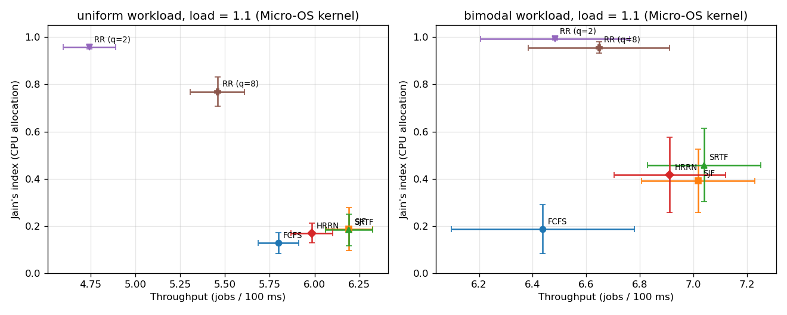
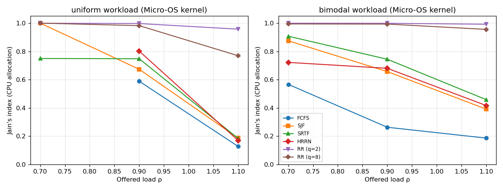
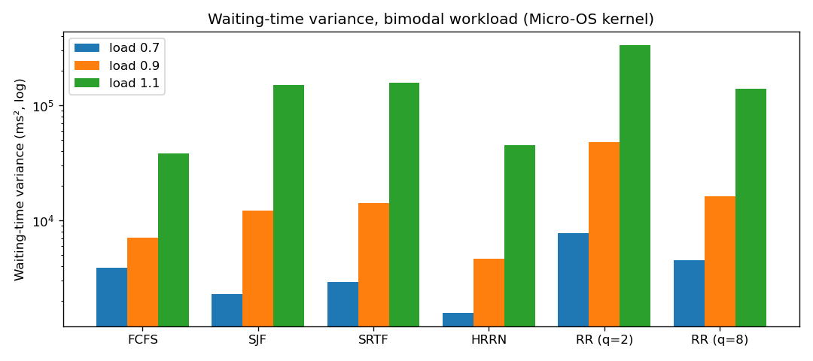
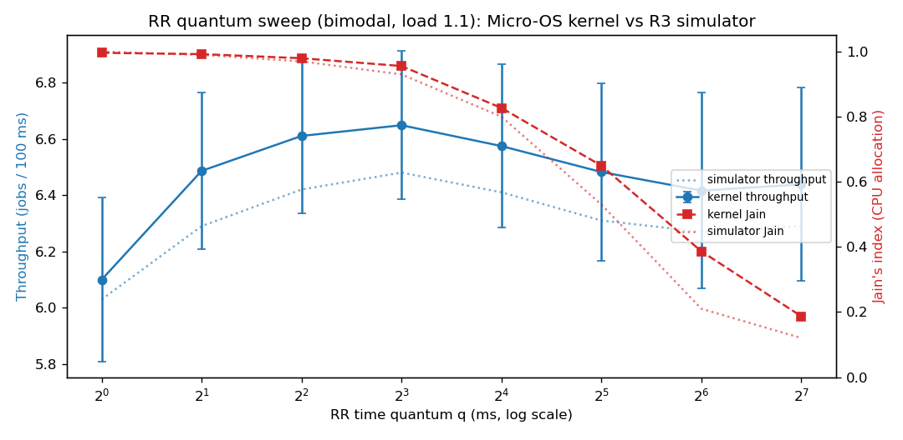
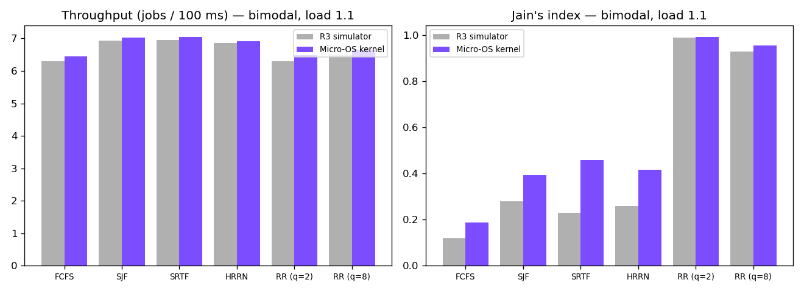

# R3 on the Micro-OS kernel: measured results

Kernel runs: 10 seed(s) per configuration, 5000 ms arrival window, 200 µs modelled context-switch cost, Jain's index over 250 ms intervals. Mean ± 95% CI (1.96·s/√n) where n > 1. Simulator values are from the R3 report (30 seeds, 5000 ms window).

## Hypotheses

| hypothesis | simulator (R3 report) | Micro-OS kernel |
|---|---|---|
| H1: overload: SJF/SRTF highest throughput, Jain < 0.5; RR fair (≈1) | supported | supported |
| H2: underload: all policies complete about the same number of jobs | supported | supported |
| H3: RR: tiny q loses throughput to switching, large q loses fairness | supported | supported |

## Table 1: bimodal workload, ρ = 1.1

| policy | throughput (jobs/100 ms) | CPU util. (%) | context switch (%) | mean wait (ms) | wait variance (ms²) | max wait (ms) | Jain's index | simulator: throughput / Jain |
|---|---:|---:|---:|---:|---:|---:|---:|---:|
| FCFS | 6.44 ± 0.34 | 90.5 | 1.28 | 358.5 | 37,960 | 706 | 0.19 ± 0.10 | 6.29 / 0.12 |
| SJF | 7.02 ± 0.21 | 89.9 | 1.40 | 92.7 | 150,944 | 3,283 | 0.39 ± 0.13 | 6.94 / 0.28 |
| SRTF | 7.04 ± 0.21 | 89.9 | 2.24 | 76.5 | 158,358 | 3,337 | 0.46 ± 0.16 | 6.96 / 0.23 |
| HRRN | 6.91 ± 0.21 | 90.0 | 1.38 | 132.6 | 45,014 | 1,039 | 0.42 ± 0.16 | 6.85 / 0.26 |
| RR (q=2) | 6.48 ± 0.28 | 85.0 | 9.92 | 348.3 | 334,487 | 2,411 | 0.99 ± 0.00 | 6.29 / 0.99 |
| RR (q=8) | 6.65 ± 0.26 | 89.6 | 2.95 | 257.7 | 139,917 | 1,704 | 0.96 ± 0.02 | 6.48 / 0.93 |

## Table 2: uniform workload, ρ = 1.1

| policy | throughput (jobs/100 ms) | CPU util. (%) | context switch (%) | mean wait (ms) | wait variance (ms²) | max wait (ms) | Jain's index | simulator: throughput / Jain |
|---|---:|---:|---:|---:|---:|---:|---:|---:|
| FCFS | 5.80 ± 0.11 | 92.8 | 1.16 | 437.9 | 66,562 | 903 | 0.13 ± 0.04 | 6.05 / 0.12 |
| SJF | 6.19 ± 0.13 | 92.4 | 1.23 | 261.4 | 574,008 | 4,720 | 0.19 ± 0.09 | 6.42 / 0.12 |
| SRTF | 6.19 ± 0.13 | 92.4 | 1.58 | 259.9 | 583,130 | 4,735 | 0.18 ± 0.07 | 6.41 / 0.13 |
| HRRN | 5.98 ± 0.12 | 92.6 | 1.19 | 350.5 | 86,598 | 1,167 | 0.17 ± 0.04 | 6.23 / 0.15 |
| RR (q=2) | 4.74 ± 0.15 | 86.3 | 10.00 | 1,031.6 | 531,729 | 2,706 | 0.96 ± 0.01 | 4.95 / 0.96 |
| RR (q=8) | 5.46 ± 0.15 | 92.8 | 2.90 | 627.4 | 195,544 | 1,640 | 0.77 ± 0.06 | 5.63 / 0.78 |

Correlation between throughput and Jain's index across the six policies at ρ = 1.1: uniform r = -0.91 (simulator −0.94), bimodal r = -0.31 (simulator −0.51).

## Table 3: effect of load (bimodal workload)

| policy | thr ρ=0.7 | thr ρ=0.9 | thr ρ=1.1 | J ρ=0.7 | J ρ=0.9 | J ρ=1.1 | simulator J ρ=0.7/0.9/1.1 |
|---|---:|---:|---:|---:|---:|---:|---:|
| FCFS | 4.49 | 5.62 | 6.44 | 0.57 | 0.26 | 0.19 | 0.89 / 0.42 / 0.12 |
| SJF | 4.51 | 5.71 | 7.02 | 0.88 | 0.66 | 0.39 | 0.91 / 0.54 / 0.28 |
| SRTF | 4.52 | 5.73 | 7.04 | 0.91 | 0.74 | 0.46 | 0.87 / 0.51 / 0.23 |
| HRRN | 4.51 | 5.70 | 6.91 | 0.72 | 0.68 | 0.42 | 0.92 / 0.57 / 0.26 |
| RR (q=2) | 4.51 | 5.58 | 6.48 | 1.00 | 1.00 | 0.99 | 1.00 / 1.00 / 0.99 |
| RR (q=8) | 4.51 | 5.66 | 6.65 | 0.99 | 0.99 | 0.96 | 1.00 / 0.99 / 0.93 |

## Table 4: Round Robin quantum sweep (bimodal, ρ = 1.1)

| quantum q (ms) | 1 | 2 | 4 | 8 | 16 | 32 | 64 | 128 |
|---|---:|---:|---:|---:|---:|---:|---:|---:|
| throughput | 6.10 | 6.49 | 6.61 | 6.65 | 6.57 | 6.48 | 6.42 | 6.44 |
| CPU util. (%) | 76.2 | 85.0 | 88.2 | 89.6 | 90.2 | 90.4 | 90.5 | 90.5 |
| context sw. (%) | 19.6 | 9.9 | 5.2 | 3.0 | 2.1 | 1.6 | 1.4 | 1.3 |
| Jain's index | 1.00 | 0.99 | 0.98 | 0.96 | 0.83 | 0.65 | 0.39 | 0.19 |
| simulator throughput | 6.03 | 6.29 | 6.42 | 6.48 | 6.41 | 6.31 | 6.27 | 6.29 |
| simulator Jain | 1.00 | 0.99 | 0.97 | 0.93 | 0.80 | 0.53 | 0.21 | 0.12 |

Slowdown-based fairness (bimodal, ρ = 1.1): SRTF 0.89, RR (q=2) 0.41 (simulator: 0.89 and 0.31).

## Figures

