# Micro-OS results

**Checks:** 59 passed, 0 failed

## Scheduling runs

| run | policy | q | tasks | dispatches | avg turnaround (ms) | avg response (ms) | avg wait (ms) | Jain fairness |
|---|---|---:|---:|---:|---:|---:|---:|---:|
| tc1 | RR | 4 | 2 | 12 | 40.3 | 1.9 | 20.4 | 1.0 |
| tc2 | RR | 4 | 5 | 27 | 70.3 | 7.6 | 53.1 | 0.944 |
| tc3_q1 | RR | 1 | 5 | 95 | 68.0 | 1.6 | 50.8 | 0.959 |
| tc3_qmax | RR | 1000 | 5 | 5 | 50.8 | 33.5 | 33.5 | 0.702 |
| tc3_single | RR | 4 | 1 | 3 | 9.7 | 0.0 | 0.0 | 1.0 |
| tc3_empty | RR | 4 | 1 | 1 | 0.0 | 0.0 | 0.0 | nan |
| tc4 | RR | 4 | 48 | 384 | 195.5 | 5.8 | 189.8 | 0.953 |
| tc5_limit | RR | 4 | 64 | 64 | 29.6 | 29.5 | 29.5 | 0.671 |
| tc5_mutex | RR | 4 | 3 | 4 | 1.3 | 0.1 | 0.1 | nan |
| tc5_deadlock | RR | 4 | 0 | 4 | 0.0 | 0.0 | 0.0 |  |
| tc6_r1 | RR | 4 | 5 | 27 | 70.3 | 7.6 | 53.1 | 0.944 |
| tc6_r2 | RR | 4 | 5 | 27 | 70.5 | 7.7 | 53.2 | 0.943 |
| tc6_r3 | RR | 4 | 5 | 27 | 70.5 | 7.7 | 53.2 | 0.943 |
| coop_off | RR | 4 | 4 | 19 | 51.2 | 30.5 | 37.9 | 0.402 |
| coop_on | RR | 4 | 4 | 29 | 43.8 | 3.6 | 30.3 | 0.557 |
| race_unsync | RR | 2 | 4 | 28 | 50.6 | 2.7 | 38.1 | 0.999 |
| race_spin | RR | 2 | 4 | 64 | 92.7 | 2.6 | 62.2 | 0.978 |
| race_spin_yield | RR | 2 | 4 | 64 | 33.8 | 1.1 | 21.0 | 0.76 |
| race_mutex | RR | 2 | 4 | 3907 | 251.5 | 1.2 | 20.5 | 0.999 |
| prodcons | RR | 2 | 4 | 51 | 9.3 | 0.3 | 4.9 | 0.755 |
| cmp_rr | RR | 4 | 6 | 60 | 140.0 | 8.0 | 104.1 | 0.799 |
| cmp_prio | PRIO | 4 | 6 | 66 | 103.0 | 26.4 | 67.2 | 0.931 |
| cmp_aging | PRIO+AGING | 4 | 6 | 66 | 105.6 | 9.6 | 69.8 | 0.937 |
| cmp_mlfq | MLFQ | 4 | 6 | 52 | 124.7 | 8.2 | 88.9 | 0.829 |
| sweep_q1 | RR | 1 | 6 | 112 | 76.5 | 2.5 | 58.5 | 0.907 |
| sweep_q2 | RR | 2 | 6 | 59 | 76.6 | 4.6 | 58.3 | 0.908 |
| sweep_q4 | RR | 4 | 6 | 36 | 78.9 | 9.6 | 60.7 | 0.885 |
| sweep_q8 | RR | 8 | 6 | 24 | 78.2 | 19.6 | 60.0 | 0.864 |
| sweep_q16 | RR | 16 | 6 | 17 | 69.7 | 32.5 | 51.3 | 0.57 |
| sweep_q32 | RR | 32 | 6 | 14 | 61.1 | 42.9 | 42.9 | 0.616 |

## Synchronization (4 tasks x 1000 increments)

| variant | result | lost | time (ms) | contended | spins | mutex wait (ms) |
|---|---:|---:|---:|---:|---:|---:|
| unsync | 1432 | 2568 | 53.5 | 0 | 0 | 0.0 |
| spin | 4000 | 0 | 125.8 | 3 | 1759736 | 0.0 |
| spin_yield | 4000 | 0 | 55.1 | 3 | 36 | 0.0 |
| mutex | 4000 | 0 | 258.5 | 3902 | 0 | 685.4 |

## Allocators (4000 random operations, 256 KiB region)

| allocator | profile | ok | failed | ns/op | peak (B) | avg frag | max frag |
|---|---|---:|---:|---:|---:|---:|---:|
| bump | mixed | 1608 | 828 | 309 | 262144 | 0.00% | 0.00% |
| first-fit | mixed | 2097 | 3 | 3814 | 218976 | 52.77% | 86.23% |
| best-fit | mixed | 2099 | 2 | 5241 | 227424 | 52.63% | 85.45% |
| bump | uniform64 | 2099 | 0 | 324 | 134080 | 0.00% | 0.00% |
| first-fit | uniform64 | 2099 | 0 | 888 | 16000 | 0.06% | 0.23% |
| best-fit | uniform64 | 2099 | 0 | 1157 | 16000 | 0.06% | 0.23% |

## Plots

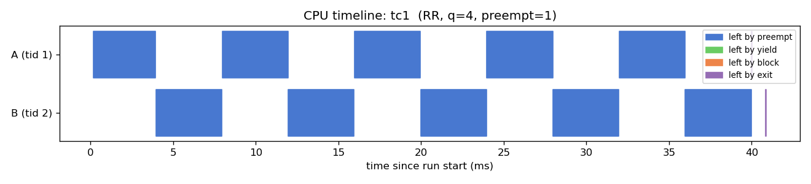
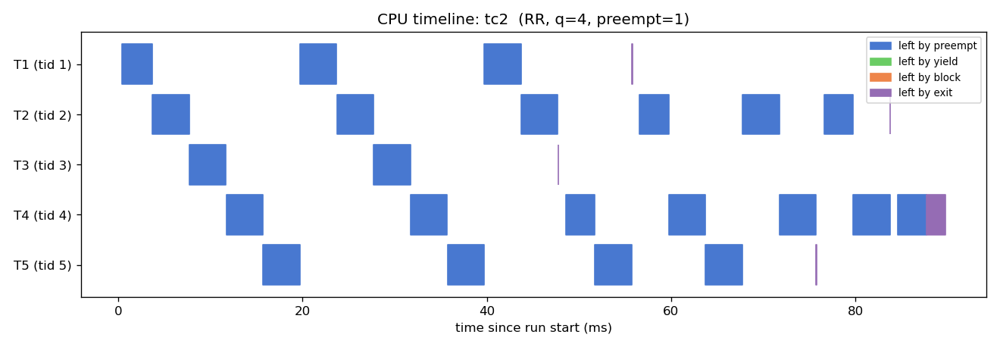
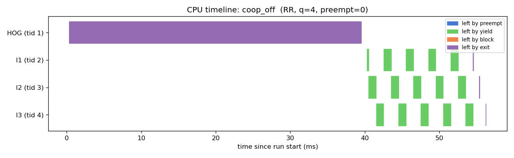
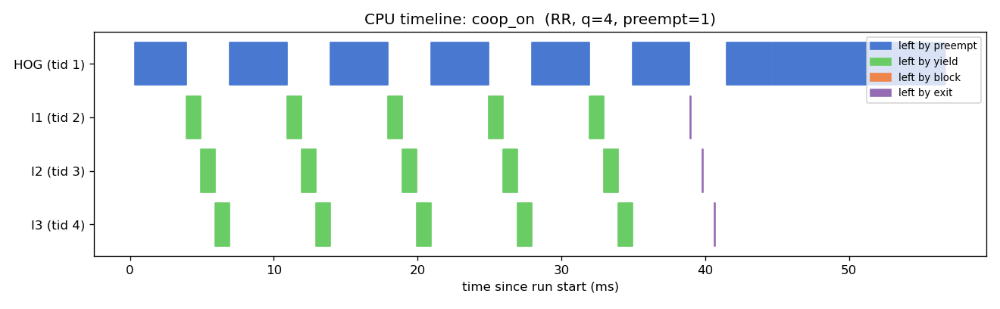
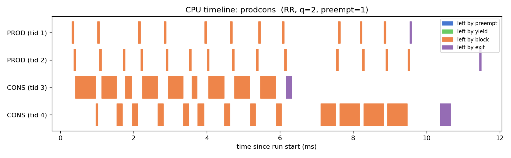
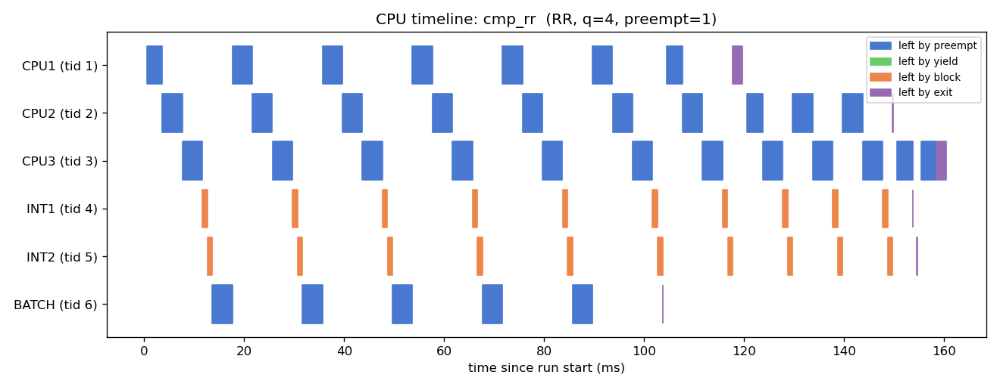
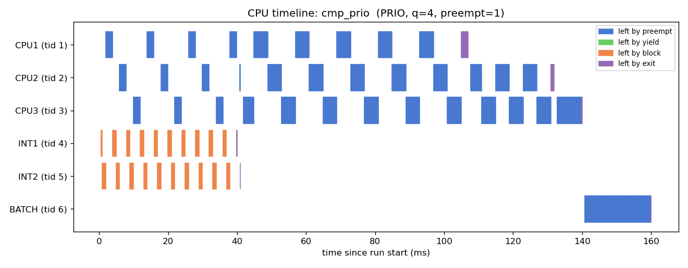
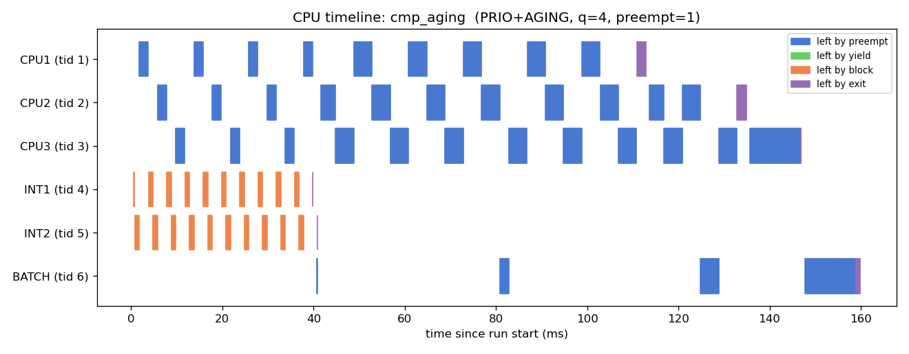
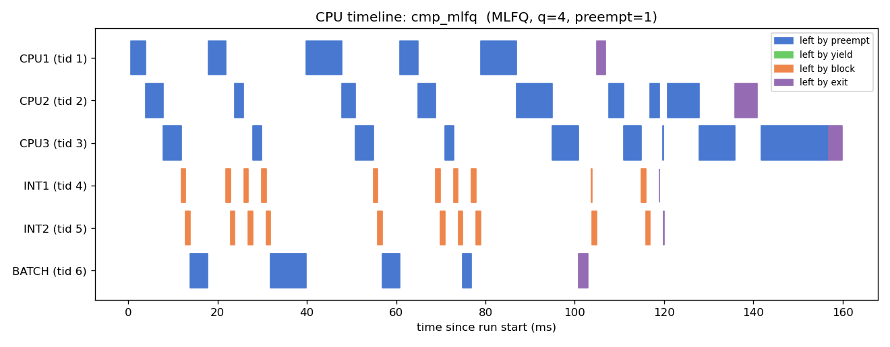
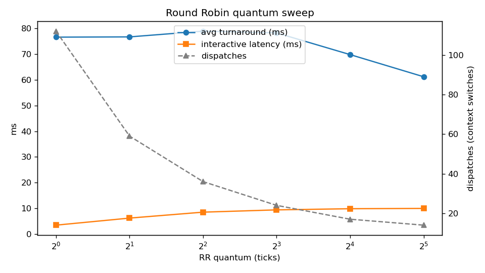
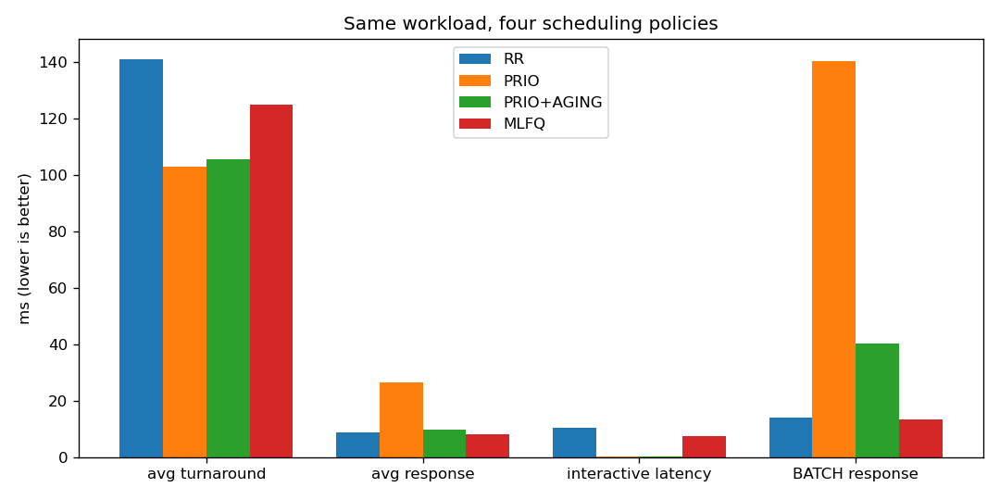
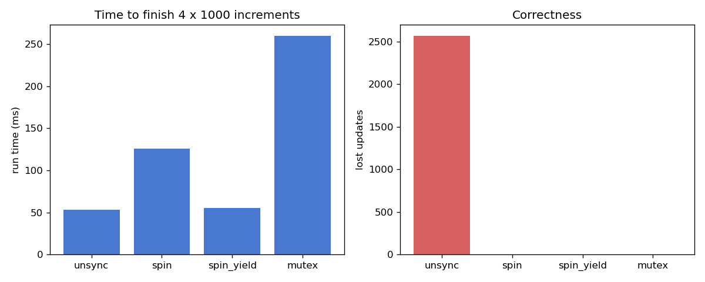
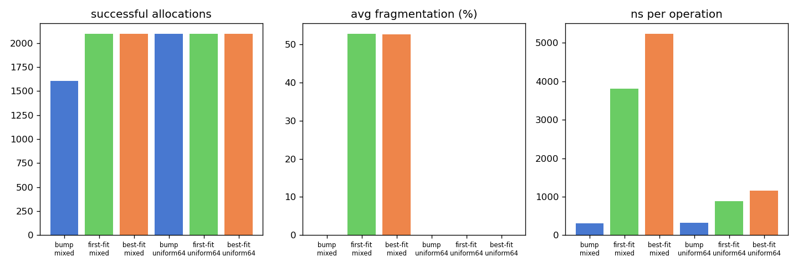
